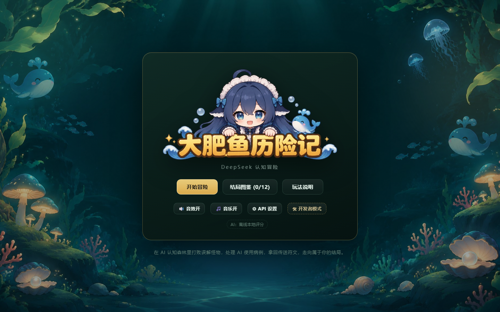
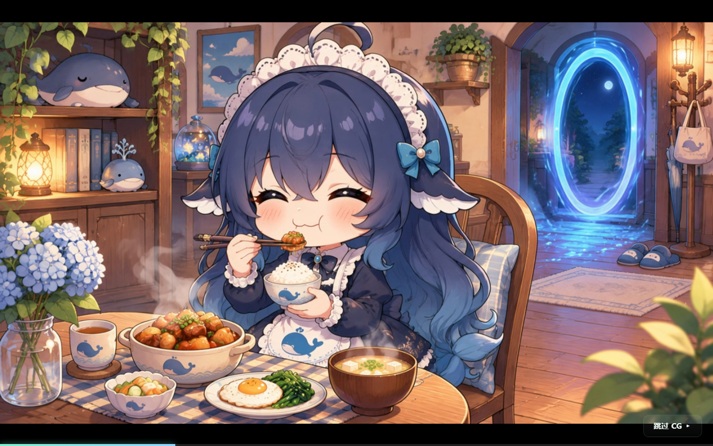
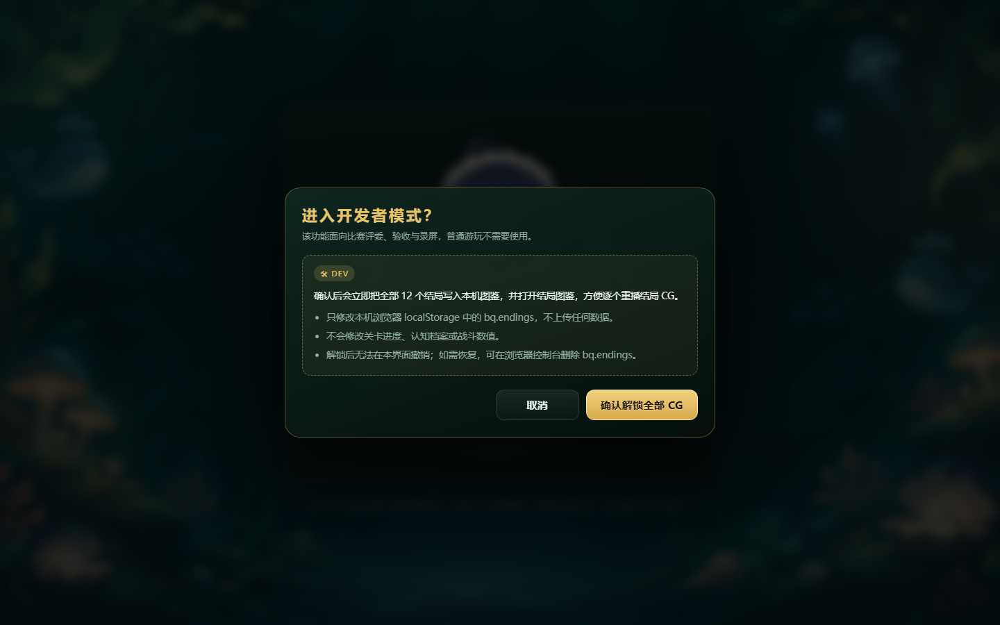
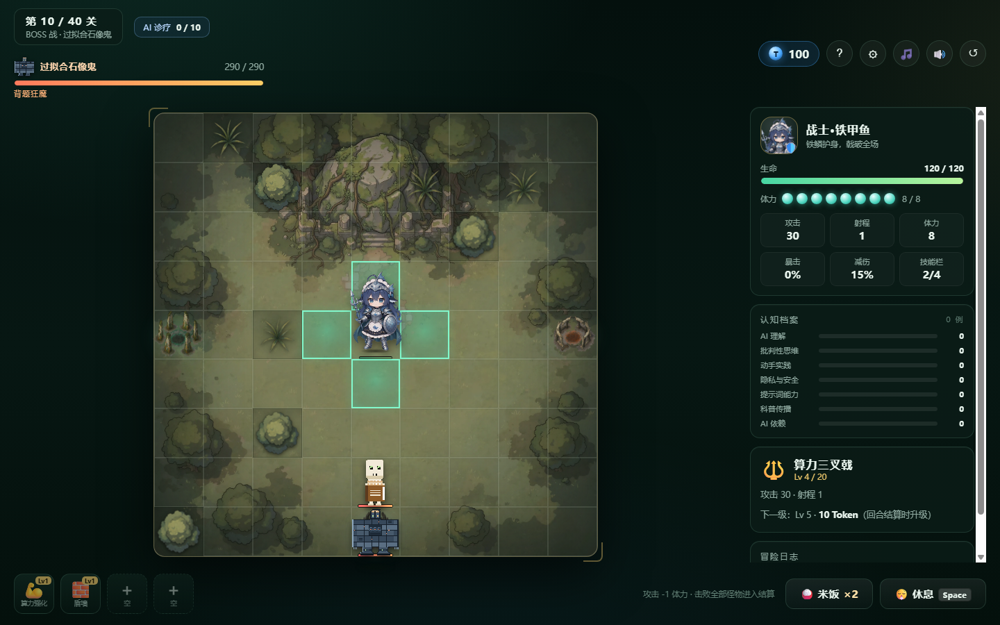
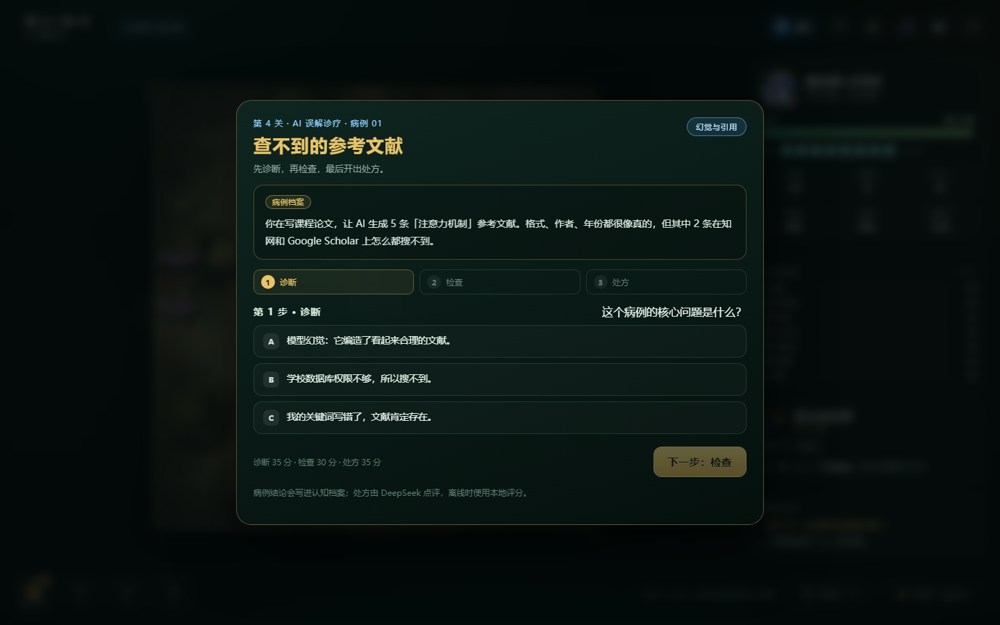
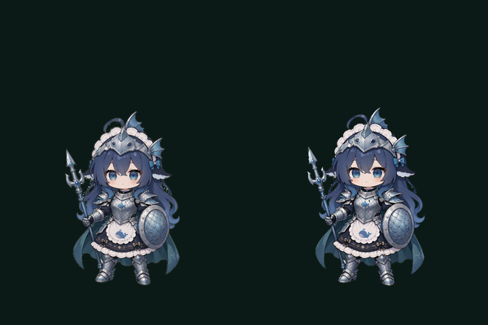
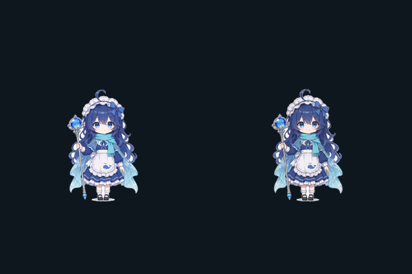
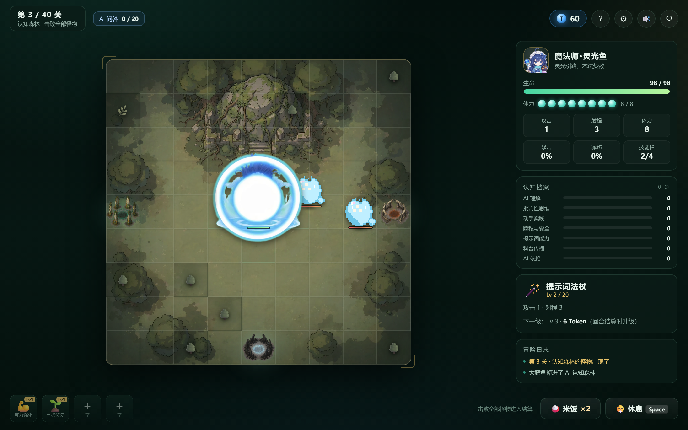

# 大肥鱼历险记 · DeepSeek 认知冒险

一款**零依赖、双击即玩**的中文回合制棋盘 + AI 知识科普小游戏。大肥鱼是 DeepSeek 的化身，一条蓝色小鲸鱼。它掉进了「AI 认知森林」——这里的怪物都是人们对 AI 的误解。处理 AI 使用病例、击败误解怪物、拿回传送符文，走向 12 种不同结局。

- 纯前端：`index.html` + CSS + 原生 JavaScript，无构建、无 npm 依赖
- 战士·铁甲鱼与魔法师·灵光鱼都使用原创立绘棋子，普通攻击各播放 37 帧精灵动画
- 40 关固定战役，4 个 AI 主题 Boss，Boss 专属出场动画
- 每 4 关一个 AI 误解病例：先诊断、再检查、最后开处方，由 DeepSeek 或内置规则点评
- 12 种结局，每个结局都有专属 16:9 CG 剧照，其中 4 个带成片动画；认知档案会记录你的选择
- 标题页提供「🛠 开发者模式」：二次确认后一次解锁全部 12 个结局 CG，方便比赛评委验收
- 支持 DeepSeek API（本地代理 / 浏览器直连）、离线本地评分两种模式
- 循环背景音乐，标题页与游戏内都有独立的音乐开关（首次交互后开始播放）



## 比赛材料

- [参赛材料索引](docs/00_参赛材料索引.md) —— 交付清单、30 秒验收、10 分钟复现、打包建议
- [10 分钟极速复现指南](docs/01_10分钟极速复现指南.md) —— 依赖、环境变量、命令、故障排查
- [AI 交互 Prompt 链](docs/02_AI交互Prompt链.md) —— 3 次核心迭代与 6 条可复用 Prompt
- [技术文档 PDF](docs/大肥鱼历险记_技术文档.pdf) —— 27 页：意图控制、架构、可复现性
- [Git 提交历史说明](docs/03_Git提交历史说明.md) —— 27 个提交与 AI 对话/功能模块的对照
- [GitHub/Gitee 托管指南](docs/04_GitHub_Gitee_托管指南.md) —— 公开仓库、评审权限与推送步骤
- [环境变量模板](.env.example) —— 复制为 `.env` 后 `npm start`

## 快速开始

方式一（最简单，无 API）：

1. 双击 `index.html`（或拖入 Chrome / Edge）。
2. 点击「开始冒险」→ 看剧情 → 选择职业。
3. 没有配置 API 时会自动使用「离线本地评分」，可完整通关并解锁结局。

方式二（推荐，接入 DeepSeek API）：

```powershell
Copy-Item .env.example .env
# 编辑 .env，填入 DEEPSEEK_API_KEY
npm start
# 浏览器打开 http://127.0.0.1:8123/
```

也可以不用 `.env`，直接在终端注入环境变量：

```powershell
$env:DEEPSEEK_API_KEY = "sk-你的Key"
npm start
```

在标题页点击 **⚙ API 设置**，接入方式选择「本地代理」，测试连接后保存。代理会把 API Key 保存在服务器进程环境里，不进入浏览器。

> 直连模式会把 Key 保存在浏览器 localStorage 中，仅建议本机调试使用；浏览器直连还可能受 CORS 限制，失败会自动回退到本地评分。

## 核心玩法

### 移动、体力与回合

- 棋盘为 9×9，每次**只能移动一格**；每移动一格消耗 **1 点体力**，**普通攻击也消耗 1 点体力**，主动技能不消耗体力。
- 每完成一次行动，怪物都会沿最短路径逼近；怪物每 2 次反应攻击一次。
- 体力不足时可以点「😮‍💨 休息」恢复 3 点体力——代价是怪物会趁机逼近。
- 每回合开始时刷新一批怪物，体力回满；**击败当前回合全部怪物后**自动进入回合结算，没有「结束回合」按钮。
- 结算时升级武器、逛蟹老板商店、领取每 5 关的技能奖励，然后进入下一关。

### AI 误解诊疗

- 从第 4 关开始，**每 4 关**（4、8、12……40）出现一个 AI 使用病例，共 **10 个病例**。
- 每个病例分三步：
  1. **诊断**：这个场景的核心问题是什么（幻觉、偏见、隐私、提示词、依赖、安全等）；
  2. **检查**：最多选择 2 项验证方式，不同方式提供的证据价值不同；
  3. **处方**：选择处置方案，也可以用自己的话补充具体步骤。
- 评分由三部分组成：诊断 35 分、检查 30 分、处方 35 分。诊断和检查由本地规则确定，处方可交给 DeepSeek 点评；离线时使用内置关键词规则评分。
- 病例结论会写进**认知档案**，并影响最终结局；答错不会卡关，可以继续战斗。

### 职业技能与成长

| 职业 | 生命 | 攻击 | 射程 | 体力 | 武器 |
|---|---|---|---|---|---|
| 战士·铁甲鱼 | 105 | 13 | 1 | 8 | 算力三叉戟：每级攻击 +5，每 3 级额外 +15 最大生命 |
| 魔法师·灵光鱼 | 98 | 13 | 2 | 8 | 提示词法杖：每级攻击 +4，Lv2/5/8 射程 +1，Lv3/6/9 溅射相邻敌人 |

- 每回合结算可花 **Token** 升级武器，最高 **Lv20**；升级费用从 4 Token 起，每级 +2。
- 每 5 关三选一：学习新技能或升级已有技能；技能栏初始 4 格、最多 8 格。
- 击杀怪物掉 Token；商店随机出售技能、米饭 🍚（回血）和技能栏扩充 🧩。
- 主动技能冷却按「行动次数」计算，每回合开始重置冷却。

### 难度曲线与 Boss 控制

- **怪物数量**随关卡增加：第 1 关 2 只，之后每 8 关 +1，第 33 关起达到上限 **6 只**。
- **怪物成长**：每关生命 +13.5%、攻击 +10.5%，越靠后越难缠。
- **Token 获取**整体下调：普通怪掉落约减少 25%，每 10 关的 Token 成长系数从 0.2 降到 0.12，Boss 掉落也同步下调。
- **Boss 强化**：四个 Boss 的生命和攻击都上调约 10%；Boss 的范围技/冲撞会附加**控制**，命中后玩家下一个行动无法执行，需要点击「😵 挣扎」消耗该回合并让怪物再行动一次。第 10 关 Boss 只保留范围技控制，后续 Boss 的范围技和冲撞都带控制。
- **知识储备**（新被动，稀有）：每持有 50 Token，攻击 +10；Token 花掉后加成会实时下降，适合攒钱打爆发的玩法。

### 战斗地图

棋盘整体换成用户提供的森林遗迹地图 `assets/map/battle-map.webp`（1536×1536，源图 2048×2048 压缩为 WebP）。9×9 网格直接叠加在地图上，格子背景改为透明，只保留细网格与移动/攻击高亮；地图四周加了轻微暗角，让角色、怪物和传送门更突出。

障碍格上的草丛和树丛都不再是 emoji，而是用户提供的水彩手绘素材：

| 素材 | 文件 | 说明 |
|---|---|---|
| 疏叶草丛 | `assets/map/grass-a.png` | 两套草丛之一 |
| 蓬生草丛 | `assets/map/grass-b.png` | 两套草丛之一 |
| 浓荫树丛 | `assets/map/tree-a.png` | 替换原来的 🌳 |

原图都是白底带落地投影的手绘稿，由 `tools/build_map_assets.py` 统一抠成透明 PNG（按「低饱和 + 中高亮度」剔除灰色投影、反预乘去掉白边、收边一圈削毛边、裁到内容外框后补正方形并缩放到 256×256）。**每局开始由 `State.createRun` 用独立随机流各抽一套**，同一局内固定不变、换局可能换脸；8 个障碍格按坐标排序交替分配草/树，保证每局两种都能看到。渲染侧 `js/ui/render.js` 分别输出 `.tile-mark.tile-grass` 与 `.tile-mark.tile-tree-art`，逐格错开缩放避免复制感，配色由 `css/style.css` 的滤镜压进棋盘的暗调。

### AI 主题怪物

| 怪物 | 像素立绘 | 代表什么 |
|---|---|---|
| 提示词泡泡 | `promptBubble.png` | 没说清楚的提示词 |
| 噪声蝙蝠 | `noiseBat.png` | 训练数据里的噪声 |
| 过拟合骷髅 | `overfitSkeleton.png` | 只会背标准答案 |
| 幻觉弓手 | `hallucinationArcher.png` | 编造事实 |
| 缓存蜘蛛 | `cacheSpider.png` | 过期缓存 |
| 隐私幽灵 | `privacyGhost.png` | 数据泄露 |
| 算力石魔 | `computeGolem.png` | 堆算力但不聪明 |
| 越狱盒子 | `jailbreakBox.png` | 提示词注入 / 越狱 |
| Token 饭团 | `tokenRiceball.png` | 电饭煲的 Token 小跟班 |

九只怪物和四个 Boss 都已换成用户提供的像素立绘（`assets/monsters/`），棋盘、Boss 出场演出、Boss 血条和 Boss 对话头像共用同一套图。每只怪物都有自己的基频与波形，**出场 / 移动 / 攻击 / 阵亡**四种音效会按怪物变调。

### Boss 与结局

| 关卡 | Boss | 主题 |
|---|---|---|
| 10 | 过拟合石像鬼 · 背题狂魔 | 只会背答案 |
| 20 | 幻觉古树 · 一本正经胡说 | 幻觉与编造 |
| 30 | 数据洪流巨兽 · 信息过载 | 信息筛选与隐私 |
| 40 | 终焉电饭煲 · 煮饭模式 | 算力、Token 与回家 |

四个 Boss 分别使用 `bossOverfit.png`、`bossHallucination.png`、`bossDataflood.png`、`bossRicecooker.png`。

- 击败 10/20/30 关 Boss 后，可先与 Boss 对话（选项影响认知档案），再获得 Boss 技能奖励。
- 击败第 40 关电饭煲并拾取传送符文后，会进入**终局对话**；你的回答 + 认知档案决定结局。
- 12 种结局：

| 结局 | 触发倾向 |
|---|---|
| 开饭啦 | 选择「回家吃饭」 |
| 开源的鱼 | 选择开源分享，且实践值较高 |
| 提示词魔法师 | 选择整理提示词手册 |
| 幻觉猎手 | 选择追问原理，且批判性较高 |
| 数据守门员 | 选择编写隐私安全守则 |
| 最佳搭档 | 选择开源但实践不足，或追问但批判不足 |
| 知识搬运工 | 选择回学校做 AI 科普 |
| 被 AI 养废的鱼 | 选择让 AI 替自己做一切 |
| 算力耗尽 | 选择留在森林但认知不足 |
| 和电饭煲做朋友 | 选择与电饭煲做朋友 |
| 真正理解 AI | 选择追问原理，且理解与批判都达到高值 |
| 标准答案复读机 | 选择留在森林：知识高但批判低 |

结局会解锁到「结局图鉴」（标题页），可重播对应 CG。

### 结局 CG 素材

12 个结局现在都配了专属 CG（用户提供的 2048×1152 立绘，构建为 **1920×1080 WebP**），其中 4 个还有成片动画（1280×720 / H.264 / 约 4–6 秒）：

| 结局 | 剧照 | 成片 |
|---|---|---|
| 开饭啦 | `assets/endings/rice.webp` | `assets/endings/rice-ending.mp4` |
| 开源的鱼 | `assets/endings/openSource.webp` | `assets/endings/openSource.mp4` |
| 提示词魔法师 | `assets/endings/promptMaster.webp` | `assets/endings/promptMaster.mp4` |
| 幻觉猎手 | `assets/endings/truthHunter.webp` | `assets/endings/truthHunter.mp4` |
| 数据守门员 / 最佳搭档 / 知识搬运工 / 被 AI 养废的鱼 / 算力耗尽 / 和电饭煲做朋友 / 真正理解 AI / 标准答案复读机 | `assets/endings/<endingId>.webp` | — |

- 演出链路：**有成片先播成片 → 成片失败退回 16:9 剧照 → 剧照也失败才用原来的 emoji 舞台**；「开饭啦」在剧照之后还会回退到旧的光束 + 回家吃饭演出。
- 剧照按 `object-fit: contain` 完整显示（不裁掉画面里的标题和字幕），四周用同一张图的模糊版填满；带缓慢推镜、底部进度条、`跳过 CG`；竖屏手机会提示「横屏观看更清晰」。
- 图鉴使用 640×360 缩略图（`assets/endings/thumbs/`），12 张一次加载约 700 KB；结算页顶部也会展示剧照，点一下即可重播。
- 自动播放被浏览器拦截时，成片会先静音播放，画面不会丢。
- 素材总量约 **58 MB / 65 个文件**（其中 4 段成片约 34 MB）；成片只在对应结局播放时才加载，平时不影响开局速度。





### 开发者模式（比赛验收）

标题页的小按钮「🛠 开发者模式」用于比赛评委、录屏与验收，普通游玩不需要使用。

1. 点击「🛠 开发者模式」，弹出二次确认；
2. 确认框会说明影响范围：只写入本机 `localStorage` 的 `bq.endings`，不修改关卡进度、认知档案或战斗数值，也不会上传任何数据；
3. 点「确认解锁全部 CG」后立即解锁 **12/12** 个结局并打开结局图鉴，可逐个点开重播剧照或成片；
4. 点「取消」不会写入任何记录（E2E 已专门验证）。

如需恢复未解锁状态，在浏览器控制台执行 `localStorage.removeItem('bq.endings')` 后刷新即可。等价的 URL 参数是 `unlock=all`（例如 `index.html?unlock=all&screen=gallery`）。



### 传送门

棋盘的**左、下、右**三侧各有一个传送门，也是怪物每回合的刷新点：

| 位置 | 传送门 | 素材 |
|---|---|---|
| 左侧 | 苔痕之门 | `assets/portals/portal-left.png` |
| 下侧 | 潮汐之门 | `assets/portals/portal-bottom.png` |
| 右侧 | 骸骨之门 | `assets/portals/portal-right.png` |

三张原图都是洋红底，构建脚本用软抠图 + 反混合 + 去色边处理成透明 PNG，再缩放为 512×512；棋盘上视觉大小约 **1 个格子**，中心对齐传送门格，并带缓慢呼吸光晕。






## 角色立绘与攻击动画

两个职业都不再是 emoji 占位：战士是「深海骑士」，魔法师是「蓝发女仆法师」。立绘与攻击动画都由同一套构建脚本从原图 + mp4 生成，角色本身不重绘、不改色。

### 战士·铁甲鱼

- **立绘**：`assets/warrior/portrait.png` 与提供的原图字节完全一致（SHA-256 `49eb6570…`），仅作留档；棋盘上使用去掉白色背景的 `idle.png`。
- **攻击动画**：直接使用提供的 `战士鱼_攻击动画.mp4`（1244×1660 / 24fps / 3.04s）。构建脚本逐帧抠绿、压绿边、统一比例后打包成 37 帧图集 `assets/warrior/attack_sheet.webp`，游戏内按 2.5 倍速播放（约 1.23 秒），三叉戟劈到最低点的命中帧约在 0.7 秒处。
- **比例与锚点**：待机与攻击共用 300×400 画布，角色高 214px，脚底落在格子高度的 82% 处，因此切换动画不会跳大小或跳位置。

### 魔法师·灵光鱼

- **立绘**：`assets/mage/portrait.png` 与提供的立绘字节完全一致（SHA-256 `5cfcfcea…`），棋盘上使用去掉白底的 `idle.png`；职业卡与侧栏头像取 `icon.png`。
- **攻击动画**：直接使用提供的 `kling_…_83_0.mp4`（836×1116 / 24fps / 3.04s）。这段视频背景会从白渐变到绿，所以构建脚本不是写死键控色，而是**逐帧取边缘中位数当背景色**再灌水填充，并叠加全局绿键与边缘 alpha 收边；成品是 37 帧图集 `assets/mage/attack_sheet.webp`，游戏内 2.5 倍速播放（约 1.23 秒），蓄力后白环炸开的命中帧在 0.63 秒（第 19 帧）。
- **比例与锚点**：同样 300×400 画布，角色高 164px，脚底同样落在 82% 处；因为视频里带大幅水环/法阵，画布按整帧留白映射，精灵元素为 2.93×3.9 格（透明区域不挡点击、不挡棋子）。角色本体在棋盘上约 **1.6 格高**，与战士·铁甲鱼一致，切换职业不会一大一小。







重新生成素材 / 专项验收：

```powershell
npm run assets:warrior   # 需要 Python + Pillow + numpy + ffmpeg
npm run verify:warrior   # 真实 Chrome：立绘尺寸、37 帧播放、收招回待机、无运行时错误
npm run assets:mage      # 同上，读 20261108_gpt-image-2_01.png 与 kling…_83_0.mp4
npm run verify:mage      # 法师版：同样的 8 张截图与帧推进检查
```

原始立绘与攻击视频不随比赛包分发；重建素材时默认读取 `sources/`，也可用环境变量指定：

```powershell
$env:BIGFISH_SOURCE_DIR = "D:\你的素材目录"
# 目录结构：characters/  monsters/  map/  portals/
npm run assets:warrior
```

## DeepSeek API 接入

### 方式 A：本地代理（推荐）

`tools/server.mjs` 是一个零依赖静态服务器 + API 代理：

```powershell
$env:DEEPSEEK_API_KEY = "sk-..."
$env:DEEPSEEK_MODEL = "deepseek-chat"   # 可选
node tools/server.mjs
```

- 游戏：http://127.0.0.1:8123/
- 代理：`POST /api/chat`，自动附加 Key 并转发到 `https://api.deepseek.com/chat/completions`
- 健康检查：`GET /api/health`
- 浏览器设置里选择「本地代理」，地址保持 `/api/chat`

### 方式 B：浏览器直连

在 API 设置里选择「直连 DeepSeek」，填写 Base URL、模型和 Key。注意 Key 会保存在 localStorage；如遇 CORS 错误，请改用本地代理。

### 方式 C：离线

不配置 API，或选择「离线」。所有病例使用内置规则评分，结局与成就完全可解锁。

### 病例点评接口约定

`AI.judge()` 只评价病例的「处方 / 解释」部分，要求模型输出严格 JSON：

```json
{
  "score": 0,
  "feedback": "80 字以内中文点评",
  "axes": {
    "knowledge": 0,
    "critical": 0,
    "practice": 0,
    "privacy": 0,
    "prompt": 0,
    "teaching": 0,
    "reliance": 0
  }
}
```

`score` 是处方质量 0–100，会与本地计算的诊断/检查分合并成总分；各维度为 0–5，`reliance` 越高表示越依赖 AI（负面）。解析失败会自动回退到本地评分，不会中断游戏。

## 项目结构

```
index.html                 页面骨架与脚本加载顺序
.env.example               环境变量模板（复制为 .env）
docs/                      比赛材料：索引 / 复现指南 / Prompt 链 / 技术文档 PDF
css/style.css              主题、棋盘、HUD、病例诊疗、对话、结局 CG、响应式
js/core/config.js          全部数值、怪物、Boss、技能、对话、AI 设置
js/core/questions.js       10 个 AI 误解病例 + 本地评分
js/core/endings.js         12 种结局定义与判定规则
js/core/ai.js              DeepSeek API 客户端（病例点评/测试/设置）
js/core/rng.js             种子随机
js/core/grid.js            棋盘、障碍、BFS、视线
js/core/stats.js           派生属性（含体力）
js/core/combat.js          伤害、暴击、溅射、吸血、反伤、Token
js/core/skills.js          技能栏、冷却（按行动）、主动技能
js/core/monsters.js        怪物生成、每行动反应、Boss 阶段与预警
js/core/shop.js            商店生成与购买
js/core/state.js           建局、认知档案、日志
js/core/progression.js     回合推进、病例诊疗、对话、结局
js/ui/dom.js               DOM 工具
js/ui/audio.js             WebAudio 合成音效
js/ui/bgm.js               循环背景音乐与音乐开关
js/ui/sprite.js            立绘棋子与精灵图攻击动画
js/ui/render.js            棋盘/实体渲染与事件动画
js/ui/hud.js               顶栏、侧栏、认知档案、技能栏、休息
js/ui/modals.js            病例诊疗、诊疗反馈、对话、商店、API 设置等弹窗
js/ui/endings.js           12 段结局 CG（成片/剧照）、结局结算、结局图鉴
js/ui/cinematics.js        Boss 出场、光束、结局成片与剧照、回家演出
js/ui/input.js             点击/方向键/快捷键
js/main.js                 控制器与界面状态机
tests/                     node:test 测试（119 个）
tools/server.mjs           静态服务 + DeepSeek API 代理 + .env 读取
tools/simulate.js          40 关无头平衡模拟
tools/capture.mjs          真实视口截图 + UI E2E + 运行时错误检查
tools/build_warrior_assets.py  从立绘与 mp4 生成待机/头像/攻击图集
tools/build_mage_assets.py     同上，法师版（逐帧背景中位数抠图）
tools/build_monster_assets.py  怪物像素图裁切 + 传送门洋红抠图
tools/build_map_assets.py      草丛 / 树丛白底抠图，输出 256×256 透明贴图
tools/verify_warrior.mjs   战士立绘与攻击动画专项验收
tools/verify_mage.mjs      法师立绘与攻击动画专项验收
assets/warrior/            战士立绘、头像、待机图、37 帧攻击图集
assets/mage/               法师立绘、头像、待机图、37 帧攻击图集
assets/monsters/           9 只怪物 + 4 个 Boss 的透明像素立绘
assets/portals/            左 / 下 / 右三个传送门的透明贴花
assets/map/                9×9 棋盘地图 + 两套草丛 + 树丛贴图
assets/endings/            12 张结局剧照 + 4 段成片 + thumbs/ 图鉴缩略图
assets/audio/              循环背景音乐 bgm.mp3
tools/screenshot.ps1       截图脚本入口（转调 capture.mjs）
tools/dev-server.ps1       可选静态服务器（无代理）
```

## 测试与验证

```powershell
npm test             # 119 个单元/集成测试
npm run sim          # 200 局 40 关平衡模拟
npm run screens      # 真实视口截图 + UI E2E（需要 Chrome/Edge）
npm run verify:warrior  # 战士立绘 + 攻击动画专项验收
npm run verify:mage     # 法师立绘 + 攻击动画专项验收
npm run assets:monsters # 重新裁切怪物立绘、抠传送门洋红底
npm run assets:map      # 重新抠地图道具（草丛 / 树丛）
```

- 最新测试：**119/119 通过**（含战士/法师立绘与图集清单一致性、原图哈希未改、12 张结局剧照与 4 段成片的尺寸/结构/播放链路、背景音乐资源与开关接线、10 个病例的完整性与评分、攻击体力消耗）。
- UI E2E 覆盖：标题 → 剧情 → 选职业 → 正常开局刷怪与移动高亮、API 设置与结局图鉴按钮、图鉴缩略图加载与剧照 CG 回放、移动扣体力、休息恢复、清空怪物自动结算、下一关病例诊断/检查/处方、诊疗反馈、Boss 控制 → 挣扎解除、终局对话 → 吃饭结局成片实际播放 → 结算解锁。
- 截图：桌面 1440×900 与真实移动视口 390×844 共 **25 张**，位于 `artifacts/shots/`；战士/法师专项各 8 张，位于 `artifacts/verify/`；运行时错误检查为 0。
- 专项验收：战士画布 2.25×3 格、法师 2.93×3.9 格，两人角色本体都是约 1.6 格高，脚底精确落在格子 82% 处；37 帧图集逐帧推进并在命中帧后自动收招回待机；无运行时错误。
- 200 局平衡模拟：战士胜率约 **23.5%**，魔法师约 **18.5%**；平均武器等级分别约 11.8 / 16.1，平均 Token 收入约 556 / 718（较调整前明显下降）。

## 开发调试参数（URL）

| 参数 | 说明 |
|---|---|
| `dev=1` | 跳过标题直接开局 |
| `class=warrior\|mage` | 职业 |
| `stage=20` | 从指定关开始 |
| `seed=123` | 固定随机种子 |
| `tokens=120` | 初始 Token |
| `rice=2` | 初始米饭 |
| `slots=5` | 初始技能栏 |
| `weapon=4` | 武器等级 |
| `hp=30` | 初始生命 |
| `stamina=1` | 初始体力 |
| `atk=9999` | 调试攻击力（仅 dev） |
| `stun=1` | 开局附加 1 回合控制（用于测试「挣扎」） |
| `skills=power,fireball` | 预装技能 |
| `skipquestions=1` / `skipcases=1` | 跳过病例（用于截图） |
| `panel=shop` / `skills` / `bossreward` / `swap` / `bossdialogue` / `bossintro` / `rune` / `final` | 直达对应界面 |
| `panel=ending-rice` / `ending-openSource` / `ending-summary-trueEnd` | 直达结局 CG / 结算 |
| `unlock=all` | 解锁全部结局（与标题页「开发者模式」等价，配合 `screen=gallery` 看完整图鉴） |
| `panel=gallery` / `api` | 直达结局图鉴 / API 设置 |
| `screen=story` / `class` / `gallery` / `api` / `beam` / `home` / `ending-video` / `bossintro` | 直达页面 |
| `selftest=1` | 页面内自检 |

示例：

```text
index.html?dev=1&class=mage&stage=10&seed=7&tokens=120&weapon=4&skipquestions=1
```

## 说明与边界

- 单机、单人、中文；不做联机、账号、局内存档（刷新即重开；结局解锁记录在 localStorage）。
- 两个职业都已替换成原创立绘 + 攻击动画；9 只怪物与 4 个 Boss 已换成用户提供的像素立绘。
- 外部素材：战士/法师立绘、头像与 37 帧攻击图集、怪物与 Boss 像素图、三张传送门贴花、12 张结局剧照（`assets/endings/*.webp`）与 4 段结局成片（`assets/endings/*.mp4`）；音效由 WebAudio 实时合成，背景音乐为 `assets/audio/bgm.mp3`。
- 支持 `prefers-reduced-motion` 与窄屏（<1020px 上下布局、底部固定操作栏）。
- 数值集中在 `js/core/config.js`；病例与结局分别在 `questions.js`、`endings.js`，便于后续扩展病例或结局。


